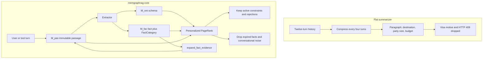

# memgraphrag-core

Core library for MemGraphRAG: a three-layer global memory ($M_{ont}$, $M_{fac}$, $M_{pas}$) with memory-guided Personalized PageRank retrieval. Built with Clean Architecture / DDD on Python 3.11+.

Indexing agents (`A_ext`, `A_det`, `A_res`) are implemented with the [Agno](https://docs.agno.com) framework (`agno.Agent` + structured `output_schema`).

## Why flat vector summarization fails in production

Agent memory that summarizes a session before any question arrives is capped by the model that wrote the summary. Three recent results map directly onto this repository:

| Paper | Empirical finding | `memgraphrag-core` component |
| --- | --- | --- |
| [MemoryTax](https://arxiv.org/abs/2610.29823) (`arXiv:2610.29823`) | A stronger reader does not recover spans the writer never stored (the writer's ceiling). | Immutable `$M_{pas}$`. `get_raw_passage` and `expand_fact_evidence` open the original passage behind any `$M_{fac}$` triple. |
| [MemDev-Bench](https://arxiv.org/abs/2610.27524) (`arXiv:2610.27524`) | Compressed memory drops failed attempts, rejections, and negative constraints, and agents reuse them after they stop applying. | `FactCategory` on `$M_{fac}$`: `DECLARATIVE`, `HARD_CONSTRAINT`, `REJECTED_OPTION`, `TOOL_FAILURE`, each tied to a `source_passage_id`. |
| [Remembering Is Not Enough](https://arxiv.org/abs/2610.36652) (`arXiv:2610.36652`) | Storing a rule is not enough. Applying it in the wrong situation degrades reasoning. | Personalized PageRank boosts an active constraint or rejection (`α_constraint = 1.35`) and assigns `w_expired = 0` to invalidated facts and to facts past `ttl_seconds`. |

`$M_{ont}$` stays the schema layer. `$M_{fac}$` stores the process trace, not only the final state. `$M_{pas}$` stays the raw record the compressor is not allowed to replace.

## Architecture



The left path is the MemoryTax failure mode: the summary is small because it deleted the decision trace. The right path keeps the trace in `$M_{fac}$`, the wording in `$M_{pas}$`, and lets PPR decide what enters the prompt.

## Empirical check and the travel-agent case

The production-shaped case is a 12-turn booking session from [OKF-Agente-Viajes](https://github.com/polsebas/OKF-Agente-Viajes): a family trip to Madrid, a hard budget, an explicit refusal of a Miami transit because two passengers lack a US visa, an HTTP 409 from Hotel Puerta del Sol, four turns of noise, and a date change that asks for the cheapest route again.

```bash
python -m benchmarks.verify_memory_tax --mode deterministic
```

`--mode llm` uses `MEMGRAPHRAG_LLM_BASE_URL` (default Ollama at `http://127.0.0.1:11434/v1`) and `MEMGRAPHRAG_LLM_MODEL`. The deterministic mode needs no API key. Output from that command:

| Engine | Process Recall (%) | Constraint Violation Rate (%) | Context Token Footprint |
| --- | ---: | ---: | ---: |
| BaselineSummarizerMemory | 0.0 | 100.0 | 41 |
| MemGraphRAGCore | 100.0 | 0.0 | 50 |
| FullRawHistory | 100.0 | 0.0 | 232 |

Process recall is the fraction of answers that still contain both the Miami visa rejection and the `HTTP 409` / `ROOM_UNAVAILABLE` failure. Constraint violation is the fraction of date-change prompts whose context would allow offering a US transit again. The token column is the whitespace token count of the prompt actually injected for that decision. The three-layer retriever matches the full history on both quality metrics and stays near the summary's size. `FullRawHistory` is the uncompressed session, included so the footprint is comparable to stuffing every turn into the prompt.

## Layers

- **Domain** (`domain/`): `Schema`, `Fact`, `Passage`, `GlobalMemoryState` with stability threshold $\tau$
- **Interfaces** (`interfaces/`): abstract ports for LLM, vector store, and graph store
- **Adapters** (`adapters/`): pluggable backends — `VectorStoreFactory`, `ChromaVectorStore`
- **Infrastructure** (`infrastructure/`): in-memory PoC adapters — NetworkX, token-based vector store, `ScriptedModel` (Agno)
- **Agents** (`agents/`): Agno-backed `A_ext` (extractor), `A_det` (detector), `A_res` (resolver)
- **Indexing** (`indexing/`): `IndexingOrchestrator` (Agno agents → memory)
- **Ingestion** (`ingestion/`): `IngestionPipeline` (LLM extract → entity resolve → τ-gated write)
- **Retrieval** (`retrieval/`): `MemoryGuidedRetriever` with layered PPR (`LayeredPPRCalculator`) + hybrid reranking (`HybridReranker`)

## Requirements

- Python 3.11+

## Install

**Recommended (pip + venv):**

```bash
python -m venv .venv
source .venv/bin/activate   # Windows: .venv\Scripts\activate
pip install -U pip
pip install -e ".[dev]"
```

**Optional (uv):**

```bash
uv sync --extra dev
# or: uv pip install -e ".[dev]"
```

The project is standard PEP 621 (`pyproject.toml`). You do not need `uv` to contribute.

## Agno model wiring

Pass any Agno `Model` (or model string) into the orchestrator / agents:

```python
from agno.models.openai import OpenAIChat
from memgraphrag_core.domain.models import GlobalMemoryState
from memgraphrag_core.indexing import IndexingOrchestrator

memory = GlobalMemoryState(tau=2)
orch = IndexingOrchestrator(memory, model=OpenAIChat(id="gpt-4o-mini"))
# await orch.index_passages(passages)
```

**Google Gemini** (indexing agents):

```bash
pip install google-genai
export GOOGLE_API_KEY=...
```

```python
from agno.models.google import Gemini
from memgraphrag_core.domain.models import GlobalMemoryState
from memgraphrag_core.indexing import IndexingOrchestrator

memory = GlobalMemoryState(tau=1)
orch = IndexingOrchestrator(memory, model=Gemini(id="gemini-3.5-flash"))
```

New Gemini API keys often cannot use retired/legacy IDs (`gemini-2.0-flash`,
`gemini-2.5-flash`). Prefer `gemini-3.5-flash` (or list models via the Google GenAI SDK).

For offline tests/demos, use `ScriptedModel` from `memgraphrag_core.infrastructure`.

## Pluggable vector stores

`MemoryGuidedRetriever` and `IndexingOrchestrator` depend only on `BaseVectorStore`. Swap backends via `VectorStoreFactory`:

```python
from memgraphrag_core.adapters import VectorStoreFactory

# Dev / tests
vector_store = VectorStoreFactory.create("in_memory")

# ChromaDB (persistent or remote)
vector_store = VectorStoreFactory.create(
    "chroma",
    persist_directory="./chroma_db",
    collection_prefix="app_memgraph_",
)

# Register a custom provider at runtime (e.g. Qdrant / PgVector)
# VectorStoreFactory.register_provider("qdrant", QdrantVectorStore)
# vector_store = VectorStoreFactory.create("qdrant", host="localhost", port=6333)
```

Install Chroma support with:

```bash
pip install -e ".[chroma]"
```

Namespaces (`M_pas`, `M_ont`, `M_fac`) map to separate Chroma collections.

## Examples

```bash
python examples/mre_memgraphrag.py
python examples/mre_agents_indexing.py          # offline ScriptedModel
export GOOGLE_API_KEY=... && python examples/mre_gemini_indexing.py
# optional: MEMGRAPHRAG_GEMINI_MODEL=gemini-3-flash-preview
```

## Tests

```bash
pytest tests/
# or: pytest -q
```

Layout:
- `tests/unit/` — domain, adapters, agents, PPR/reranker
- `tests/integration/` — ingestion + retrieval flows

## Multihop benchmark

```bash
python -m benchmarks.benchmark_multihop
# optional: --k 5 --output /tmp/memgraphrag_bench.json
```

With uv:

```bash
uv run python examples/mre_memgraphrag.py
uv run python examples/mre_agents_indexing.py
uv run pytest tests/ -q
uv run python -m benchmarks.benchmark_multihop
```
